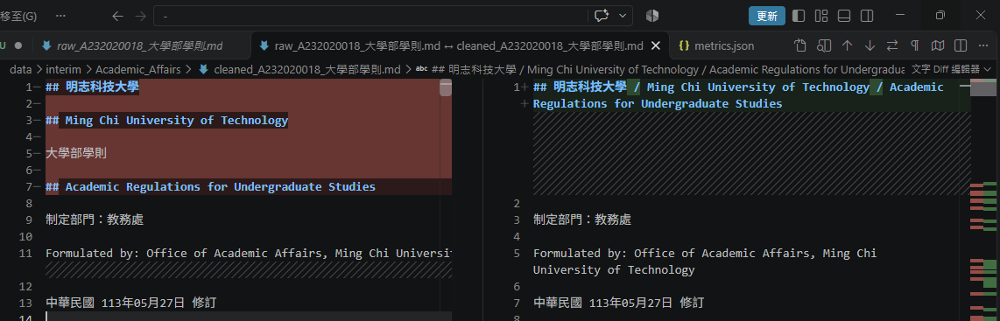
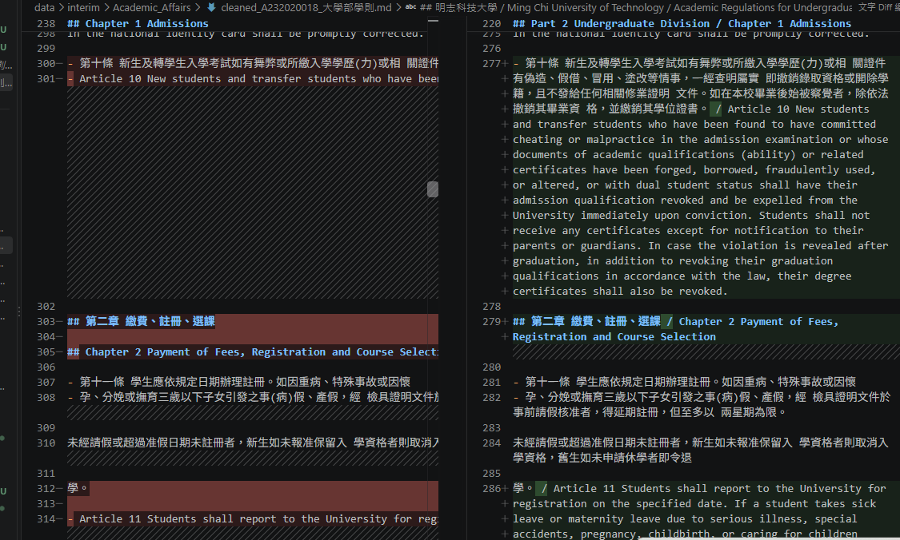
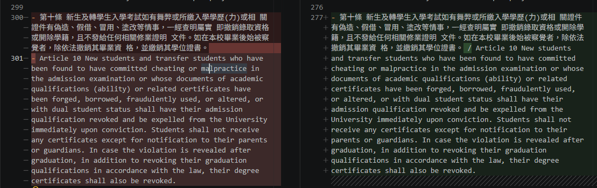
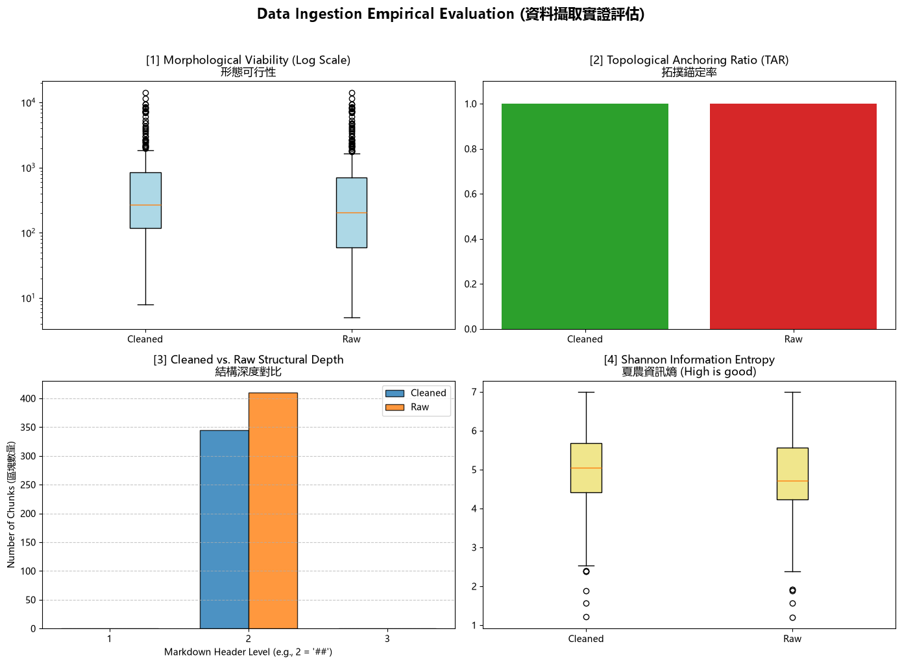

# 資料前處理報告 (Data Preparation Report)

> 期中評量 · NLP 自然語言處理 115-S1
> 填寫方式：請把所有「（ ）」與 `___` 替換成你自己的內容，並刪除 `>` 開頭的說明文字。

- **學號 / 姓名**：U12627002 王垠錚
- **專案名稱**：-
- **完成的任務**：
- [X] 1-A 頁首頁尾清除　
- [X] 1-B 雙語標題合併　
- [X] 1-C 雙語條文合併

---

## 1. 資料集概覽 (Dataset Overview)

> 數字來源：`01_Data_Ingestion.ipynb` 第 2 節 (掃描 PDF) 與第 5 節 (批次處理) 的輸出。


| 類別 (Cluster) | PDF 數量 | 清洗前 chunk 數 | 清洗後 chunk 數 |
|---|---:|---:|---:|
| Academic_Affairs     |  3  |  96  |  65  |
| Library_Information  |  3  |  248 |  225 |
| Student_Affairs      |  3  |  66  |  55  |
| **合計**             |**9**|**410**|**345**|


**問題 (2–3 句)：** 清洗後 chunk 數量變少了多少？是哪個任務造成的？有沒有哪個任務**不影響** chunk 數量？為什麼？

清洗後的 chunk 數量由 410 減少至 345，共減少 65 個，約減少 15.9%。切塊規則以換行後的 ##  標題作為分界，因此任務 1-A 刪除帶有 ## 的頁首頁尾，以及任務 1-B 合併連續雙語標題，都可能減少切塊邊界。任務 1-C 合併的是一般條文清單，沒有移除 ##  切塊邊界，因此這份程式中的該任務不影響 chunk 數量。
> 提示：chunk 是用什麼規則切開的？請看 notebook 第 5 節的 `chunking_regex`。

___

## 2. 清洗步驟 (Cleaning Steps)

> **截圖來源：** `data/interim/<類別>/` 中的 `raw_*.md` (清洗前) 與 `cleaned_*.md` (清洗後)，也就是批次處理存下的**真實檔案**。
>
> **[重要] 不可使用 notebook 中的範例。** notebook 任務 1-A、1-B、1-C 的測試文字 (第二十一條、明志科技大學 / Ming Chi University of Technology、第十五條 / Article 15) **不能**作為你的截圖。請在真實檔案中**另找一處**，可以是其他 PDF 的檔案。使用範例的截圖**不給分**。
>
> **截圖方法 (VS Code 比較檢視)：**
> 1. 在檔案總管對 `raw_<檔名>.md` 按右鍵 → **Select for Compare**。
> 2. 對同一份文件的 `cleaned_<檔名>.md` 按右鍵 → **Compare with Selected**。
> 3. 左右並排顯示，紅色 = 刪除，綠色 = 新增或修改。按 `Ctrl + F` 搜尋，找到該任務造成的變更。
> 4. 每個任務截**一張**圖，存到 `reports/figures/`，**檔名必須完全相同** (否則圖片不會顯示)：
>    * 任務 1-A → `1a_compare.png`
>    * 任務 1-B → `1b_compare.png`
>    * 任務 1-C → `1c_compare.png`

### 2.1 任務 1-A：頁首頁尾溢出清除

- 檔名：raw_A232020018_大學部學則.md 與 cleaned_A232020018_大學部學則.md　搜尋的文字：大學部學則
- 截圖：
- 改變了什麼：刪除整行只有法規名稱「大學部學則」的文字；此處連文件開頭的正式中文名稱也被刪除。
- 這對之後的問答檢索有什麼幫助：清除正文中重複出現的頁首頁尾，可減少雜訊；若該行帶有 ##，也能避免產生多餘的切塊邊界。但誤刪正式名稱可能影響文件名稱的辨識與檢索。
- 這個任務有沒有改錯的地方：有。檔名為 cleaned_A232020018_大學部學則.md，搜尋文字為「大學部學則」。比較原始檔第 5 行與清洗後的開頭，可看到正式中文名稱被刪除。清洗規則只判斷整行是否等於法規名稱，沒有區分正式名稱與重複頁首頁尾。

### 2.2 任務 1-B：雙語標題合併

- 檔名：raw_A232020018_大學部學則.md 與 cleaned_A232020018_大學部學則.md　搜尋的文字：第二章
- 截圖：
- 改變了什麼：原本分開的中文標題「第二章 繳費、註冊、選課」與英文標題「Chapter 2 Payment of Fees, Registration and Course Selection」，合併成同一行，只保留第一個 ##，中間以「 / 」連接。
- 這對之後的問答檢索有什麼幫助：讓中英文標題與後續條文保留在同一個 chunk，避免中文標題被切成沒有內文的獨立區塊，也有助於中英文查詢找到同一段內容。
- 這個任務有沒有改錯的地方：此處沒有發現。中英文標題正確合併，下方第十一條內容仍保留。

### 2.3 任務 1-C：雙語條文合併

- 檔名：raw_A232020018_大學部學則.md 與 cleaned_A232020018_大學部學則.md　搜尋的文字：Article 10
- 截圖：
- 改變了什麼：將原本分開的中文第十條與英文 Article 10 連接，移除英文條文前的「- 」，並以「 / 」銜接。
- 這對之後的問答檢索有什麼幫助：讓中英文對照關係更清楚，方便模型一起理解同一條規定。本程式以 ## 標題切塊，因此這項修改主要改善區塊內的文字排列，不會減少 chunk 數量。
- 這個任務有沒有改錯的地方：此處沒有發現。第十條與 Article 10 的條號相符，畫面中的中英文內容仍有保留。

## 3. 評估指標與 AI 解讀查證 (Metrics & Verifying the AI's Interpretation)

### 3.1 指標數據表

> 數字來源：專案根目錄的 `metrics.json`。[1]、[2] 必填；[3]、[4] 選填。
> 「參考值」由老師在課堂上公布 (完成全部任務的結果)。

| 指標 | Raw | Cleaned (你的) | Cleaned (參考值) |
|---|---|---|---|
| [1] 中位數長度 Median Length | | | |
| [2] 拓撲錨定率 TAR | | | |
| [3] 深度變異量 SDV (選填) | | | |
| [4] 中位數資訊熵 Entropy (選填) | | | |

> **儀表板截圖：** 你自己的 `01_Data_Ingestion.ipynb` **第 6 節**輸出的 4 拼圖儀表板 (第 8 週執行並保留的輸出)。截圖後存為 `reports/figures/dashboard.png`。第 3.2 節也會用到這張截圖。



你的 Cleaned 結果與參考值一致嗎？若一致，寫「一致」；若不一致，找出原因。（1 句）

___

### 3.2 AI 的解讀

> 把第 3.1 節的儀表板截圖 (`dashboard.png`) 交給 AI，請它解讀結果。將 AI 的回答**完整貼在這裡**，並註明使用的 AI 工具。

- 使用的 AI 工具：_chatgpt__

1. 形態可行性（chunk 長度）
清洗後的中位數長度為 272 字元，高於清洗前的 204 字元，表示清洗後的典型區塊較長，與合併原本分開的中英文內容的效果相符，但仍須比較實際檔案才能確認原因。兩組都有超過一萬字元的長區塊，表示清洗後仍存在區塊過長的問題。

2. 拓撲錨定率（TAR）
清洗前後都是 100%，表示依照程式的判定規則，所有區塊都符合錨定條件。不過，這不代表標題內容一定正確，也不能證明每個區塊都具有完整、適合檢索的語意。

3. 結構深度
圖中清洗前後的區塊都集中在 Markdown 第 2 層標題，與 SDV 都為 0 的結果一致。清洗後的區塊數量也比清洗前少，但確切減少數量應以程式輸出為準。深度一致只能說明標題層級一致，不能證明文件的章節關係完整保留。

4. 夏農資訊熵
清洗後的中位數資訊熵從約 4.7149 上升到 5.0484，表示典型區塊的字元分布較分散。清洗後仍有低資訊熵的區塊；例如指定的機車管理辦法目錄，包含大量空白與表格符號，資訊熵為 2.56。資訊熵衡量字元分布，不能直接代表內容正確性或檢索價值。

整體而言，清洗前後的區塊長度、數量與字元分布有所改變，但仍有過長區塊與低資訊熵區塊。是否改善問答檢索，需要進一步檢查原文、清洗結果與實際檢索表現。
（貼上 AI 的回答）
```

3.3 你的查證 (至少兩點)

> 挑 AI 說得最肯定的兩句話，回到你的檔案或程式中找證據：它說的是真的嗎？

**查證 1**

AI 的說法： 清洗前後 TAR 都是 100%，表示依照程式的判定規則，所有區塊都符合錨定條件，但不代表標題內容一定正確。

我查了什麼： 01_Data_Ingestion.ipynb 第 6 節的 get_tar() 函式，以及 metrics.json 的 TAR 數值。函式使用 re.match(r'^\s*#+', record["text"])，只檢查區塊開頭在可選空白之後，是否有一個以上的 #。

結論： 正確。
Raw 與 Cleaned 的 TAR 都為 1.0，表示全部區塊都通過這個檢查。但程式沒有檢查標題是否完整、是否符合 Markdown 標題格式，或是否與內文相關。例如指定的長 chunk 以 ## Ming 開頭，也會通過檢查。

- AI 的說法：___
- 我查了什麼 (哪個檔案、哪個 chunk、哪段程式)：___
- 結論：正確 / 部分正確 / 錯誤，因為 ___

**查證 2**

AI 的說法： 資訊熵衡量字元分布，不能直接代表內容正確性或檢索價值。

我查了什麼： 01_Data_Ingestion.ipynb 第 6 節的 get_entropy() 函式，以及 cleaned_A242100008_學生機車管理辦法.md 第 75 行開始的指定目錄 chunk。

結論： 正確。
函式使用 Counter(text) 計算所有字元的出現次數，包含空白、換行與表格符號，再計算夏農資訊熵，沒有判斷文字的意思或正確性。這個目錄 chunk 的資訊熵為 2.56，雖然有大量重複格式，仍能提供條文主題與頁碼，因此低資訊熵不等於沒有用途。

- AI 的說法：___
- 我查了什麼：___
- 結論：正確 / 部分正確 / 錯誤，因為 ___

### 3.4 實際證據：你被指定的 chunk

> 執行 `09_midterm_chunks.ipynb`：填入你的學號與老師在課堂上公布的 SEED，按 Run All。
> 每位同學拿到的 chunk 不同。請**連同驗證碼**一起填入。
> 程式只顯示前 400 字元的預覽。請在 VS Code 打開程式列出的**閱讀用檔案** (`data/interim/` 中的 `cleaned_*.md`，與 JSON 內容相同但有正常換行)，按 `Ctrl + G` 輸入程式給的**行號** (或按 `Ctrl + F` 搜尋「搜尋用」文字)，從該行讀到下一個 `## ` 標題為止，就是**完整**的 chunk。

- **SEED**：___

**(a) 很長的 chunk**
- 資料檔 (JSON)：___　位置：第 ___ 個 (從 0 開始數)　長度：___ 字元　驗證碼：___
- 閱讀用檔案 (`.md`)：___　從第 ___ 行開始
- 前 3 行內容：
  ```text
  （貼上）
  ```
- 這是什麼樣的文字？為什麼會這麼長？___
- 之後做問答檢索時，這麼長的 chunk 可能造成什麼問題？___

**(b) 資訊熵很低的 chunk**
- 資料檔 (JSON)：___　位置：第 ___ 個 (從 0 開始數)　資訊熵：___　驗證碼：___
- 閱讀用檔案 (`.md`)：___　從第 ___ 行開始
- 內容：
  ```text
  （貼上）
  ```
- 為什麼它的資訊熵這麼低？它對問答檢索有用嗎？___

## 4. 一個尚未解決的問題 (One Remaining Problem)

> 打開 `data/interim/` 中任一個 `cleaned_*.md` (與 `data/processed/` 的 JSON 內容相同，但有正常換行，比較好讀)，找出一個清洗後**仍然有問題**的 chunk。
> 每個 chunk 從一個 `## ` 標題開始，到下一個 `## ` 標題之前結束。
> 例如：只有標題沒有內文、表格亂掉、中英文沒有對齊、還有殘留的頁首頁尾、斷行造成的多餘空白，或是**清洗造成的錯誤** (誤合併、誤刪除)。
> **不可**使用第 3.4 節的兩個 chunk。

- **檔名**：cleaned_A271010023_圖書館管理作業規範.md
- **從第 ___ 行開始**
- **標題**：## Attachment 5 / Comparison Table of Unit Recommendation Points in Database
- **我是怎麼找到的**：從 01_Data_Ingestion.ipynb 第 6.1 節得知，這是清洗後最長、同時資訊熵最低的 chunk，再到 cleaned Markdown 搜尋「## Attachment 5 / Comparison Table」檢查表格。

- **問題 chunk（部分內容）**：

```text
欄名節錄：Number of Databases Recommended by X Unit - 1 2
第 1 列儲存格節錄：140 140
第 3 列儲存格節錄：65 61
```

- **問題是什麼**：表格疑似出現欄位合併或錯位，部分儲存格包含多個數字，難以確認每個分數對應哪個欄位。此外，整個 chunk 長達 14350 字元，包含大量空白與重複格式。
- **可能的原因**：PDF 表格可能含有合併儲存格或複雜排版，Docling 轉換時未完整還原欄列關係；目前的清洗規則只處理頁首頁尾與雙語文字，沒有修復表格。切塊規則只依 ## 標題分割，也讓整張表格保留在同一個大區塊。實際錯位原因仍須對照原始 PDF。
- **具體的修正方法**：先對照原始 PDF 核對表頭與數字位置，再修復欄列對應，不能直接把同格的數字自行拆開。確認正確後，按列分組切塊，每塊保留完整欄名與附件名稱，並移除儲存格中多餘的排版空白。
- **對問答檢索的影響**：欄位對應不清可能讓模型引用錯誤分數；過長且充滿重複格式的區塊，也會增加上下文用量，使模型較難找到正確的數值。


- **檔名** (`cleaned_*.md`)：___　**從第 ___ 行開始** (VS Code 左側的行號)　**標題**：___
- **我是怎麼找到的** (例如：搜尋了什麼、看了哪個檔案)：___
- **問題 chunk (貼上部分內容)**：

```text
（貼上）
```

- **問題是什麼**：___
- **可能的原因** (PDF 本身？Docling 轉換？清洗的正則表示式？切塊規則？)：___
- **具體的修正方法** (例如：一條規則、一個正則表示式的構想、長度上限)：___
- **對問答檢索的影響**：___

## 5. AI 協作 (AI Collaboration)


- 使用工具：ChatGPT。
- 協作內容：協助解讀四格儀表板、整理資料集統計、分析指定 chunk，並說明清洗前後的差異。
- 我的查證：檢查 get_tar() 與 get_entropy() 的計算方式，並比較 raw、cleaned Markdown 的實際內容。
- 發現的問題：文件開頭的正式中文名稱「大學部學則」也被清洗規則刪除；附件五表格則有多個數字擠在同一儲存格的情況，仍需對照原始 PDF 確認。
- 學習與反思：不能只看指標或直接接受 AI 的解讀，必須用程式和原始資料核對。TAR 為 100% 不代表語意完整，資訊熵高低也不能直接代表檢索價值。


- 本次作業的 AI 協作紀錄請見 [`AI_USAGE.md`](AI_USAGE.md) 的「Week 04 / 08」與「Week 09」段落。
- 這次使用 AI 最大的收穫或教訓是 ___（請具體：例如提示詞中哪一段最關鍵、AI 哪一句解讀不正確）
